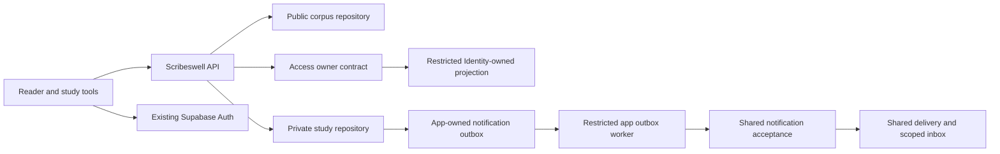
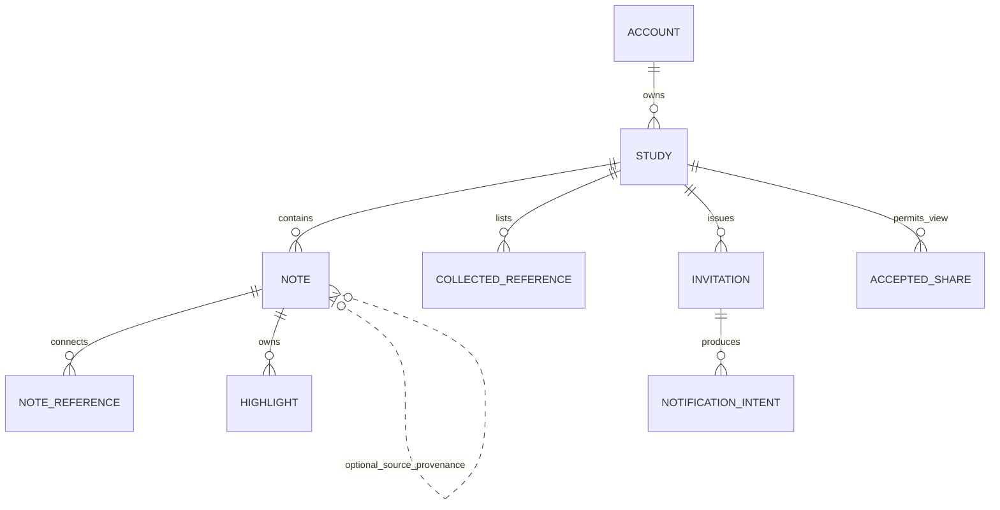

# Architecture Spine — Scribeswell studies

## Design Paradigm

Retain the existing layered Scribeswell silo: React reader/editor → FastAPI application contracts → Scribeswell-owned persistence. Access exposes authorized account evidence using restricted Identity-owned projections; this feature does not require a separate Identity HTTP service. Shared notifications use their owning authorized contract. Existing manifests/lockfiles own framework versions; no new stack, upgrade or rich-text package is selected here.

This draft fixes feature-level consistency boundaries. D-1–D-5 below are pre-implementation gates, not endpoints/tables presumed to exist. It authorizes no runtime, migration, grant, notification or Leave implementation.

## Inherited Invariants

| Authority | Binds here |
| --- | --- |
| [ADR-0001](../../../platform/docs/architecture/decisions/0001-fastapi-openapi-api-boundary.md), [ADR-0003](../../../platform/docs/architecture/decisions/0003-application-silo-architecture.md) | App business data through FastAPI/OpenAPI, owned schemas and HTTP service boundaries. |
| [ADR-0019](../../../platform/docs/architecture/decisions/0019-current-server-side-authorization.md), [ADR-0053](../../../platform/docs/architecture/decisions/0053-capability-scoped-access-in-mixed-scope-applications.md), [ADR-0047](../../../platform/docs/architecture/decisions/0047-public-access-and-launcher-visibility.md) | Current account capability plus resource authority for private actions; public corpus and launcher policy unchanged. |
| [ADR-0032](../../../platform/docs/architecture/decisions/0032-session-recovery-and-return-navigation.md), [ADR-0033](../../../platform/docs/architecture/decisions/0033-draft-lifecycle-and-late-save-protection.md), [ADR-0050](../../../platform/docs/architecture/decisions/0050-inline-draft-save-failure-and-exit-confirmation.md), [ADR-0051](../../../platform/docs/architecture/decisions/0051-saving-conventions-by-workflow.md) | Identity-safe recovery, explicit lifecycle/revisions, acknowledged saves and exit-only confirmation. |
| [ADR-0006](../../../platform/docs/architecture/decisions/0006-common-notification-capability.md), [ADR-0022](../../../platform/docs/architecture/decisions/0022-short-transactions-and-external-service-calls.md), [ADR-0020](../../../platform/docs/architecture/decisions/0020-safe-schema-changes-and-release-recovery.md) | Application notification intent, shared delivery, short local transactions and controlled compatible release. |
| [ADR-0021](../../../platform/docs/architecture/decisions/0021-revocation-and-in-flight-operations.md) | Bounded already-executing authorization, fresh checks on restarted work and no distributed atomic revocation promise. |

## Invariants & Rules

### AD-1 — Application and platform ownership [ADOPTED]

- **Binds:** All capabilities and service integrations.
- **Prevents:** Cross-owner table access, business rules in shared UI and duplicate authorization/delivery engines.
- **Rule:** Scribeswell owns studies, notes, highlights, invitations, resource shares and private-response relationships. Identity owns account/actor/recipient evidence; Access owns admission/capabilities; common notifications own channel rendering/attempts/deduplication/read-state. External owners are reached through their authorized contracts, never imported server implementations or direct tables. Browser Supabase remains auth-only; new business contracts are generated/validated from owning OpenAPI.

### AD-2 — Public reading and protected eligibility [ADOPTED]

- **Binds:** CAP-1, CAP-7, CAP-9; authentication, Access and discovery consumers.
- **Prevents:** Forced organization/PtS onboarding, JWT-only permission checks and login-triggered grant resurrection.
- **Rule:** Every verified signed-in reader is eligible for personal studies without administrator approval, organization or employment. Access must implement that explicit account policy through D-1; the existing legacy organization `/v1/check` does not do so. Scribeswell checks current account admission/capability then current owner/share/private-note rules on protected requests. Ordinary sign-in or repeated enrollment cannot restore an explicitly revoked/suspended entitlement. No browser permission/account/actor claim is authority. Public Bible routes remain anonymous-capable and independent of protected discovery/verification outages; launcher eligibility is unchanged.

### AD-3 — Private persistence cannot inherit corpus permissions [ADOPTED]

- **Binds:** All new private reads/writes, deployment and database composition.
- **Prevents:** Granting public corpus readers access to private notes or broadening import/runtime authority.
- **Rule:** Private study persistence uses its own restricted runtime role/pool and owner-local constraints/RLS, separate from the existing public-corpus reader and corpus importer. No table-owner, migrator or service-role credentials in runtime/browser. Private repository context comes from verified account/actor evidence; study-sharing and note-visibility predicates govern all supported query/write paths, including search/counts and pool reuse. API checks do not replace database structural protection. Missing private configuration/readiness fails protected requests safely without exposing data or making public reading require a private dependency.

### AD-4 — Relationship and visibility boundaries [ADOPTED]

- **Binds:** CAP-1–CAP-4, CAP-7, CAP-8, CAP-10; storage, reads, copies and search.
- **Prevents:** Duplicated note bodies, automatic passage membership and private-response disclosure by containment.
- **Rule:** A writable note belongs to an own destination study/account. Its document, linked passage references and owned highlights form one note; the study’s passage list is a separate relationship. Phrase/passages are context, not duplicate note instances. Ordinary notes follow current study view sharing. Private responses remain owner-only even within an already/later shared study; their highlights, snippets, counts and search results are equally private, with no first-version override. Duplicate note preserves that visibility; another reader’s study copy excludes private content. A source relationship is provenance, never permission.

### AD-5 — Independent private responses and source loss [ADOPTED]

- **Binds:** CAP-8, CAP-10; provenance, own-study destination and deletion.
- **Prevents:** Source-delete cascades, hidden source-text copying and loss of personal writing.
- **Rule:** First private response explicitly chooses/creates an own study, then reuses its per-source-study destination. Change affects future notes. The same response is displayed alongside accessible source content and in the owner’s study. Source study/note deletion or revoked access cannot cascade-delete or make the owner’s response undiscoverable; unavailable-source presentation preserves the response and public scripture links, without returning inaccessible source content. Provenance must survive source absence without a live cross-owner cascade dependency. Exact retained metadata/deletion representation is centralized in D-2, not chosen independently by consumers.

### AD-6 — One versioned note write boundary [ADOPTED]

- **Binds:** CAP-3, CAP-4, CAP-8–CAP-10; editor, highlight tools and private writes.
- **Prevents:** Text/highlight branches drifting, stale overwrite and deleted-note resurrection.
- **Rule:** A note revision covers its document, note-reference connections and highlight set. Changes use the same owner-local transaction and serialized per-note client save lane; local typing may continue while an earlier outcome is unresolved, but cannot authorize a competing request. Server checks current resource authority, explicit expected revision and editability with each write. Missing/deleted updates never become creates. Explicit create/duplicate/conflict-copy have distinct replay-safe operation identity; response loss is reconciled before another attempt. Study metadata/passage-list revisions and share/invitation authority are separate from note-text revisions, with lifecycle dependencies checked in the same local write boundary.

### AD-7 — Conflict recovery preserves the editing branch [ADOPTED]

- **Binds:** CAP-8, CAP-9; concurrent edits and copy recovery.
- **Prevents:** Silent merge/overwrite, accidental duplicates and newer server marks combined with older local writing.
- **Rule:** A stale revision pauses affected autosave and retains the local editor while open. Review latest precedes explicit Use latest with discard explanation or Save mine as a new note. That new-note command copies the writer’s coherent text/reference/highlight branch, retaining private visibility, subject to current destination authority and replay-safe creation. It does not overwrite the newer original. No full version-history product is introduced; exact conflict-branch evidence and bounds belong to D-2.

### AD-8 — Source-aware occurrence anchors [ADOPTED]

- **Binds:** CAP-2–CAP-4, CAP-6; public corpus imports and private highlights.
- **Prevents:** Screen/text-offset drift, matching every lemma occurrence and silent reattachment after correction.
- **Rule:** An anchor identifies its source/corpus, declared revision, scripture/versification context and exact ordered word occurrence(s), with server-validated source evidence sufficient to detect changed targets. Current word IDs alone are not proof that unchanged text survives a corpus replacement. Cross-verse continuous selections may use multiple explicit occurrence segments in one note; disconnected Ctrl-click selections are out of scope. An uncertain target becomes Needs review while the note/reference stays; repair explicitly reselects words. No automatic quotation or requirement to retain old full editions. Unsupported text supports references/notes but no fabricated word anchor. One owner-defined anchor format under D-2 serves picker, renderer, writes and migration checks.

### AD-9 — Safe versioned note document [ADOPTED]

- **Binds:** CAP-3, CAP-9; editor, API, search and rendering.
- **Prevents:** Browser-only sanitization, incompatible rich text and reference insertion changing other relationships.
- **Rule:** Use one versioned, server-validated structured note document for the approved paragraphs/marks/lists/source links/reference links; raw pasted HTML is not a trusted storage or rendering contract. D-2 owns its closed node/mark/link schema, size/depth limits and compatibility. Reference links retain canonical passage identity and reading-versus-editing actions; inserting one neither adds study passage membership nor creates highlights/quotations. Mixed Hebrew/English direction is presentation metadata, not a rewritten scripture identity.

### AD-10 — Invitation and accepted-share lifecycle [ADOPTED]

- **Binds:** CAP-7, CAP-8, CAP-10; invitation handling and notifications.
- **Prevents:** Bearer-link grants, read-state acceptance, duplicate authority and revived withdrawn invitations.
- **Rule:** Scribeswell owns recipient-bound invitation state separately from accepted resource shares. Acceptance is explicit, for the verified intended account. Obtain current account/capability and recipient evidence outside local write locks; the bounded executing operation follows ADR-0021. The local transaction atomically validates invitation state, recipient binding/evidence validity and the server's 30-day pending deadline, then establishes the share. Remote revocation is not distributed-atomic with that transaction. Restarted execution rechecks authority; a committed acceptance retry cannot recreate a subsequently removed share. Accepted sharing persists under current policy until removed; its lifetime is not that deadline. Reminders do not create duplicate access. Owner-issued renewal after expiry is explicit, never a delayed acceptance/retry resurrecting old authority. Notification opens/read flags have no acceptance effect; forwarded links do not authorize reading. Source removal does not delete recipient-owned work. D-1 fixes recipient binding, execution/evidence bounds, concurrent accept/revoke, current authority, decline and renewal protocol before delivery.

### AD-11 — Durable notification intent and separate scope [ADOPTED]

- **Binds:** CAP-7; notification/inbox delivery and worker operations.
- **Prevents:** Lost invitations after commit, external waits under locks and organization-grant borrowing.
- **Rule:** Required notification intent commits with Scribeswell invitation state in its owned outbox, alongside required operation/evidence. Handover occurs after lock release through the shared acceptance/dedup contract; shared channels/read-state never write study authority. Outbox workers have restricted owner identity, versioned payloads and recoverable bounded shutdown/retry. Account-scoped Scribeswell delivery/inbox must remain distinct from Leave organization details/count authority. Reuse shared capability/UI contracts as first consumer without implementing Leave or requiring an independently deployed microservice by default. No channel success claim from accepted intent; final selected channel/UI scope is D-3.

### AD-12 — One frontend context owner [ADOPTED]

- **Binds:** CAP-2–CAP-6, CAP-9, CAP-11; reader, tool panel, selection and editor.
- **Prevents:** Word clicks changing highlight destination, tool toggles discarding input and wrong-pane analysis.
- **Rule:** Reader workspace state distinguishes active study, current highlight-destination note, inspected selection/pane and visible Studies/Analysis tool. All tool entry points use the same per-note editing/save state, not independent editors. Passage and note-reference navigation preserve current note unless explicit note selection changes it; tool toggles retain input. Workspace tabs each hold up to four independent panes with stable identities, positions and per-tab study/current-note associations. New tabs inherit associations, not data copies. One per-note edit/save lane is shared across tabs; stale inactive views cannot overwrite it. The one Studies/Analysis panel follows active tab/pane. Tab switching retains editing; layout closing never deletes records and guards the last unresolved editing context. Keep sequential chapter arrows and browser history, not separate pane history ledgers. Public history/URL snapshots contain no private associations or content; a closed-tab replay can restore public reading only, never private editor state. D-4 owns one versioned bounded snapshot/navigation contract before consumers implement it. Mobile tools replace reading with an explicit return and conditional selection actions. Same-user authorized session recovery restores supported context; account change/access loss cannot expose prior private state. No sensitive editor contents in URLs or unreviewed durable browser storage.

### AD-13 — Operations and compatible release [ADOPTED]

- **Binds:** All delivery units, data changes and deployment.
- **Prevents:** Broad credentials, coupled public/private failure, source damage and unsafe activation.
- **Rule:** Preserve existing public corpus/import authority and same-origin application routing. New private endpoints are authenticated routes, never added to the manifest’s public Bible allowlist. Separate public/API, protected-feature, outbox/worker and channel readiness evidence; a notification-provider fault does not erase a committed invitation or falsely report channel success. Use bounded external timeouts outside locks, safe structured identifiers without note bodies/credentials/invite URLs, server UTC/account/actor attribution and immutable consequential evidence as applicable. Owner migrations precede activation through controlled compatible rollout; failure blocks dependent activation, records partial progress and uses verified explicit recovery, not automatic reversal/startup migration.

## Structural Seed

This is ownership seed, not a schema/DTO implementation. Exact physical/wire contracts are centralized through D-1–D-3 before consuming stories.

Private responses are independently owned NOTE records. Optional provenance can identify a source note or passage; it requires neither a live source note nor a separate response body. Source removal preserves unavailable-source provenance without a cascade. Account/actor and public corpus identities are verified external/owned references, not authorization inferred from an ERD edge.

Deployment inherits the existing Scribeswell web/API and public PostgreSQL path. The private-data pool and app worker are separate restricted execution contexts; shared Identity/Access/notification owners keep their migration/release authority. Local/disposable qualification precedes target activation; no new production provider or hosting move is selected.

## Capability → Architecture Map

| Capability | Lives in | Governed by |
| --- | --- | --- |
| CAP-1 | Study library/domain, account eligibility | AD-1–AD-5, AD-12 |
| CAP-2 | Reference parser/picker, public reader, collected references | AD-4, AD-8, AD-12 |
| CAP-3 | Note document/editor/domain | AD-4, AD-6, AD-9, AD-12 |
| CAP-4 | Selection tools, occurrence anchors, note aggregate | AD-4, AD-6, AD-8, AD-12 |
| CAP-5 | Shared tool panel/library/editor | AD-12 |
| CAP-6 | Existing reader panes and source context | AD-8, AD-12 |
| CAP-7 | Account policy, invitations/shares, shared notifications | AD-1–AD-3, AD-10, AD-11, AD-13 |
| CAP-8 | Private-response/copy domain | AD-4–AD-8, AD-10 |
| CAP-9 | Save coordination, private API, session recovery | AD-2, AD-3, AD-6, AD-7, AD-9, AD-12 |
| CAP-10 | Owner lifecycle/structural constraints | AD-4–AD-6, AD-10, AD-13 |
| CAP-11 | Public workspace tabs/panes, shared per-note edit coordination | AD-2, AD-6, AD-12 |

## Deferred and Readiness Gates

| ID | Single owner / required closure | Revisit before |
| --- | --- | --- |
| D-1 | Identity/Access owners: exact capability catalogue and current verified-account eligibility/self-service assignment, actor setup and revocation behavior, restricted caller policy, verified recipient proof, acceptance/reissue protocol and error/outcome contracts. Scribeswell owns resource share transitions. No app direct grant writes or generic login-to-grant shortcut. | Any protected enrollment/invitation implementation or claim that existing legacy `/v1/check` serves this feature. |
| D-2 | Scribeswell domain owner: one data/API/OpenAPI contract for note/document/visibility/reference/anchor identities, typed revisions and operation receipts, conflict-copy branch evidence, lifecycle/deletion, private provenance and safe search/counts. Coordinate stable source catalogue/import transitions. Derived clients/migrations read that same contract; no consumer independently invents shapes. | Private persistence, editor/highlight writes or copy/delete stories. |
| D-3 | Common-notification owner with Scribeswell: account-scoped receiver/inbox/read-state contracts for the selected email plus in-app delivery and Pending invitations section above accepted Shared with me studies (hidden when empty), all reaching one Accept / Decline action; accepted source intent/dispatch/retry/version/dedup/retention evidence, privacy and worker supervision. Reuse planned Leave foundation without claiming it runs. | Notification/inbox implementation and release of invitation delivery. |
| D-4 | UX/reader owner: one shared interaction contract for per-tab study/current-note and inspected selection, stable tab/pane IDs, up-to-four-pane targeting/closure, one global resource edit lane, bounded public URL/browser snapshots and closed-tab replay, keyboard/focus/status and native selection/editor transitions. Open here/ beside/new tab are explicit; no independent pane histories. Prevent replay loops, stale hidden-view writes and loss on layout closure. Qualify responsive layouts and inactive-view resource limits. Prove iOS/Android Hebrew handles, OS copy and virtual keyboard on real devices. | Shared interaction contract before reader/editor implementation; device and accessibility evidence before final acceptance of consuming stories. |
| D-5 | Application/shared release owners: restricted role provisioning, owning migration authority, private endpoint routing, compatible prior-version/schema rehearsal, feature activation/readiness and recovery procedure. Existing public surface remains usable throughout ordinary compatible delivery. | Target activation or implementation-readiness claims. |

Package choice for the rich-text editor, physical table/column/index names, local module filenames and numeric bounds belong to D-2/consuming code after the closed contract is selected. No new framework/ORM or infrastructure choice is implied. Collections/tags, more than four panes per tab, arbitrary docking/saved layouts, collaboration, full offline editing and translation/publisher-note features stay outside this feature.
