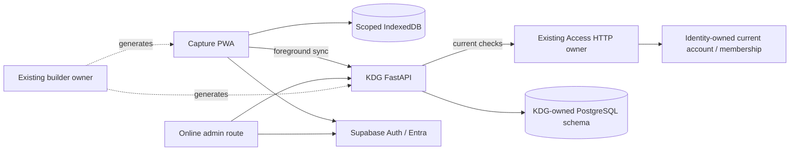

# Architecture Spine — KDG Capture

## Design Paradigm

Layered application silo with an offline local command queue. React surfaces call
application-specific state/validation and transactional local storage; foreground sync
calls FastAPI. Backend workflows authorize and own short transactions; persistence
helpers do not commit independently. Shared runtime integration is HTTP, never imported
service implementations. Domain questionnaire/child rules remain in KDG.

## Inherited Invariants

Platform ADR authority is the [accepted index](../../../platform/docs/architecture/decisions/README.md).
0001–0003,0007,0009–0023,0025,0028,0031–0033,0035,0039,0046,0050–0051,
0053,0056–0059 apply as mapped in discovery.md. Leave product rules are not inherited.
Offline local use is a new explicit KDG policy; it never relaxes ADR-0019 server checks.

## Invariants & Rules

### AD-1 — One silo and fixed organization [ADOPTED]

- **Binds:** All KDG components.
- **Prevents:** Duplicate Auth/Access/People/generators and a hardcoded authorization bypass.
- **Rule:** Retain React/Vite/shadcn, Supabase Auth/Entra and existing shared owners.
  Configure Khula's stable org_id in environment-controlled app policy, resolve/recheck it
  server-side, keep org_id non-null on domain data, and expose no organization switcher.
  No People/employment dependency. One KDG deployment may host capture/admin routes.

### AD-2 — Account permissions and domain scope [ADOPTED]

- **Binds:** API, admin, history, sync and controlled setup.
- **Prevents:** Membership-only grants, employee requirements and owner spoofing.
- **Rule:** Each server request checks exact KDG organization capability through Access,
  including global/org enablement, membership, verified account actor and caller policy.
  KDG checks assignment/ownership itself. Author is immutable account/actor from verified
  create context, editor from current verified context. All organization/cross-account
  data paths use restricted runtime DB roles, transaction-local verified context and RLS.
  Admin grant may authorize all Khula captures, never other organizations or platform
  role administration. Missing shared current checks block the slice.
  The selected shared addendum fixes the closed own_account/organization resource
  variants and exact registry/caller policy. Assignment/eligibility bind Identity's
  membership ID; rejoin allocates a new ID and requires explicit renewal. Capture
  ownership remains account-based; renewed current own-read/edit may access that
  account's old records without reviving old create eligibility.

### AD-3 — Immutable versioned questionnaire JSON [ADOPTED]

- **Binds:** Renderer, editor, provisioning, persistence and historical editing.
- **Prevents:** Wording-based keys and silent rewriting/migration of old answers.
- **Rule:** Relational identity/org/version/status/attribution wraps schema-validated
  JSONB definitions and answers. Published definitions immutable, stable question UUIDs,
  every capture/open entry pins version. Type changes allocate new question identity; wording
  edits/reorder retain it. Validate against original version at every supported write.
  Downloaded old published versions remain accepted; never substitute latest silently.

### AD-4 — Local commit before save feedback [ADOPTED]

- **Binds:** Capture/edit, storage and update handlers.
- **Prevents:** Saved feedback without recoverable data or queued intent.
- **Rule:** Persist capture snapshot, pending revision and queued command atomically
  in IndexedDB on explicit Save before Saved on this phone. Unfinished form input and
  hidden-details buffers stay in memory, never persisted as a recoverable observation
  draft or included in a false active answer. Before-Save closure may lose input.
  Use transaction completion and strict durability hint where supported; storage may
  still be evicted/deleted. No API/business-response caching by generic service worker.

### AD-5 — Ordered immutable retries and atomic server effects [ADOPTED]

- **Binds:** Queue, API and operation receipts.
- **Prevents:** Lost-response duplicates, changed-payload replays and out-of-order edits.
- **Rule:** Capture UUID and operation UUID are distinct. Freeze submitted command payload,
  version and expected revision; retry identically. Serialize per record, persist a later
  local edit behind unresolved predecessors, and freeze its expected server revision only
  when predecessor outcome is known. Atomically commit capture, server revision, immutable
  domain history and compact operation receipt. Matching authorized replay returns original
  receipt; changed-content reuse conflicts. Canonical submitted meaning follows the
  app-owned JCS v1 envelope in contracts.md; KDG uses the selected HMAC-SHA-256 v1
  disposition with stored key ID, retained verification and fail-closed loss/restore.
  Missing verification keys never authorize fresh execution. Exact secret/library
  evidence precedes affected delivery. Current access is required for outcome lookup.
  Cross-tab drainer claims and acknowledgements compare durable claim/local sequence;
  expired claims recover original outcomes, and late acknowledgements cannot replace edits.

### AD-6 — Revision conflicts require reviewed resolution [ADOPTED]

- **Binds:** All capture/admin writes and conflict UI.
- **Prevents:** Automatic last-write-wins or old offline edits erasing administrator changes.
- **Rule:** Conditional server revision update is atomic. Conflict commits no capture change;
  retain base/local/current snapshots for saved offline own edits in the authorized
  partition; online administrator attempted answers/base remain in memory only. A user explicitly
  selects server state or reviewed replacement; replacement gets a new operation ID and
  expected current revision. Preserve the conflicted local proposal, mark its command
  superseded/resolved only after durable resolution; further conflict repeats review.
  Pause dependent unsent edits for explicit re-review; never auto-rebase descendants over
  resolution. Downloads refresh server base but retain pending overlays and conflict evidence.

### AD-7 — Seven-day device-local authority [ADOPTED]

- **Binds:** Offline opening, local capture/history, sessions and queue submission.
- **Prevents:** Offline JWT claims masquerading as current server permission.
- **Rule:** Last successful online authorization provisions account/org/capabilities/
  assignment observations and local expiry after seven days. Only an exact successful
  capability/assignment refresh renews its corresponding validity; unrelated successful
  requests cannot extend cached own-create/read/edit or assignment authority. No
  offline all-read/all-edit authority is issued. Expired login does not
  invalidate that local window alone. Explicit logout, learned denial or window expiry
  locks the partition; offline local use cannot discover revocation. Every new server
  request checks current authority; queued user work cannot become service-authorized
  work. App-local clock checks are a best-effort UX bound, not tamperproof enforcement.
  Returning same account must reauthorize before unlocking after lock.

### AD-8 — Account/org partition and pending-work retention [ADOPTED]

- **Binds:** Local DB, session return, account change and downloads.
- **Prevents:** New account reading or uploading previous account's observations.
- **Rule:** Persist every sensitive record/queue key under account + org_id. Async replies
  carry partition/session generation and cannot render into a changed account. Explicit
  sign-out retains locked pending work with disclosure; no silent purge or replacement
  account submission. Generic caches contain shell assets only. Client partitioning is
  application isolation, not encryption against device access or same-origin malicious JS.

### AD-9 — Independent schema and queue compatibility

- **Binds:** Service worker, local migrations, API releases and version support.
- **Prevents:** App update deleting pending capture or making queued old work unreadable.
- **Rule:** Version definition schema, command schema, local DB and API independently.
  Upgrade local stores transactionally with tested interruption/old-to-new fixtures;
  coordinate stale connections/tabs with bounded safe handling, never reset a failed migration. Preserve pending records,
  conflicts and referenced versions. Default to update first then sync; prompt safe
  activation after open-form Save/Cancel and bounded active write/request settlement,
  not successful queue drainage. Add adapters only when changed formats require them;
  support old executing/queued payloads across ordinary releases. Unsupported
  future versions are retained with actionable block, not erased.

### AD-10 — Safe operating envelope and proven shared promotion [ADOPTED]

- **Binds:** Environments, setup, delivery, scaffolding and operations.
- **Prevents:** Startup migrations, duplicate provisioning owners and a speculative offline framework.
- **Rule:** Existing deployment coordinator runs separate KDG migration history with runtime/
  migrator/operator separation; no startup migration or automatic destructive rollback.
  Initial setup uses owner-local targeted commands/evidence, not a migration creating Auth
  accounts. KDG bootstrap publishes its validated version via the same domain rules used
  later by admin. Local/CI synthetic fixtures precede nonproduction phone validation;
  no production actions in planning. Promote only proven manifest/storage-queue/status/
  update/test patterns through existing generator/UI owners with the consuming story.
  Safe diagnostics exclude questionnaire answers; domain revision history is protected
  business data, not diagnostic payload dumps.
  The sole owner acknowledged all shared boundaries; existing owner items retain
  contracts/clients/generator/tests/runbooks, KDG integrates first-consumer proof.
  Operator executor derives from protected authenticated database-login mapping;
  normal runtime credentials cannot provision or select target users. Private target
  verification uses the shared addendum's bounded runtime/setup policies, not user
  impersonation or shared-table reads. Recipe/client extension rules belong to P1/SERVICE.

## Consistency Conventions

| Concern | Convention |
| --- | --- |
| Application identity | Display KDG Capture; proposed silo apps/kdg-capture, capability prefix kdg_capture |
| IDs and dates | UUID strings; stable actor/account kept distinct; membership IDs and revisions as positive decimal strings on wire; date YYYY-MM-DD; UTC timestamps RFC3339 |
| Creation time | Local captured_at describes device time; server created_at is first verified commit; preserve both, never treat device clock as audit authority |
| Role/resource model | Two application default roles, exact capabilities; account-own vs organization-all resource scope, KDG assignment validation |
| Queue/status | pending/in_flight/committed/attention plus durable cause; per-record ordering and bounded foreground retries |
| Saving | Explicit observation Save, no unfinished-entry persistence; config Save/Cancel; no capture approval workflow |
| Errors | Platform ADR-0031 error_id plus safe typed details, HTTP-aware recovery; no English-message branching |

## Stack and Structural Seed

The user selected newest stable versions, with exact planning pins in the
[scaffold dependency baseline](../../../platform/docs/architecture/contracts/scaffold-dependency-baseline-2026-10-14.md):
TypeScript7.0.2, React/DOM19.3.0, Vite8.3.4/plugin-react6.1.2, Node26.11.1 Current,
Python3.15.0 and uv0.13.1. Runtime/peer metadata and cp315 wheel availability are verified,
not clean-install/runtime tests. Root frontend workspace lock and independent Python
owner locks remain authority during Build. PtS/shared regression follows selection;
no existing manifests change here. TS7 compiler CLI stays distinct from any explicitly
needed legacy API tooling adapter. Native IndexedDB/service workers remain selected;
no PWA build adapter, People/Content/worker dependency or package installation added.

Proposed owned persistence: questionnaire/version, child, facilitator_assignment,
capture/capture_revision, operation_outcome. Same-org local references enforce structural
integrity; external Identity identifiers follow owner HTTP/verified actor policy.
See contracts.md for bounded wire and sequencing proposal.

Deployment seed: dedicated app origin with one API route family, nonproduction HTTPS
for device proof; reuse existing hosting/release machinery. Final hostname, package pins,
operator trust binding and compatible old/new deployment rehearsal precede activation.

## Capability → Architecture Map

| Requirement area | Lives in | Rules |
| --- | --- | --- |
| FR-1–3,12 | Auth/Access integration, KDG admin/setup | AD-1,2,10 |
| FR-4–7 | Capture renderer/explicit local Save | AD-3,4,8 |
| FR-8–11 | History, version editor, conflicts | AD-3,5,6 |
| FR-13–18 | Local storage, queue, sessions, updates | AD-4–9 |
| NFR-1–5 | Owning tests/runtime/release | AD-2,4–10 |

## Deferred and Open Decisions

ENV/P1/SERVICE direct pins/command/recipe/extension boundaries now follow the
[owning contract](../../../platform/docs/architecture/contracts/scaffold-environment-and-generation.md).
Identity/Access physical projection/constraint/role/operator models follow the
[owning execution substrate](../../../platform/docs/architecture/contracts/identity-access-execution-substrate.md).
Final WRITE outcome/evidence/role/recovery/secret selections follow the
[owning execution contract](../../../platform/docs/architecture/contracts/owned-write-and-secret-execution.md).
No load-bearing planning decision remains open for the ordered synthetic delivery.
Actual target/source adoption, owner locks/images/credentials, role/query/race/restore,
provider/device and old/new upgrade qualification remain delivery/release evidence.
Business processing/retention and device suitability remain pre-pilot policies. Normal
invitation/provider trust precedes additional facilitator onboarding; automatic
enrollment is outside MVP. No general offline runtime, Survey service, analytics,
attachment or worker foundation is needed.

Approved application policies: fixed Khula, 1–5 numbered choices, Nee defaults,
explicit Save without unfinished recovery, own-only offline PWA/online organization
admin, seven-day scoped local access, 30-day own download, historical editing after
unassignment/deactivation, ordinary-inactivity pending sync, membership-rejoin renewal
and update-first without mandatory adapters. These are decisions, not runtime evidence.

Observation scope update, 2026-10-13: proposed [KDG ADR-0001](architecture/decisions/0001-explicit-observation-save.md)
records the user-directed no-draft saving rationale. Questionnaire configuration drafts
remain separate; saved capture concurrency/queue compatibility is unchanged.

## Offline history scope clarification — 2026-10-14

No local revision archive or user-facing revision catalogue. Cache current observations,
original definitions needed by those records, pending command/base snapshots and saved
conflict branches. Internal server revisions/audit remain for concurrency/provenance;
four attribution fields remain stored for authorized administrator audit; routine
capturer details show observation date/answers and compact sync feedback. Offline capability
alone does not require storing every earlier state. Platform scaffold/UI owners own
proven domain-neutral persistence/migration, partition, queue/retry, conditional-write,
status/update and device fixtures; KDG owns observation rules and authorized APIs.

Approved surface split, 2026-10-14: offline PWA read/edit is own-only for both roles.
All-record administration/audit requires current online authorization; issue no offline
all-read/all-edit observation, and persist no other-author records on phones. This
supersedes earlier cached administrator-history wording; create-all eligibility for
the administrator's own captures remains separately registered and checked.

Administrator conflict scope, 2026-10-14: keep attempted online input/reviewed base
in memory; no server conflict-input persistence, draft API/table or close/reload recovery.
Successful mutation/audit/receipt remains atomic. Saved offline own-edit proposals retain
E2 durability. Common conditional-write/error/operation-recovery helpers stay platform
patterns, without a universal conflict-draft framework.

Ordinary deactivation amendment: previously provisioned offline child observations may
sync under current authority/assignment; inactive status alone is not rejection. Define
verified prior-eligibility evidence in app create/provision contracts before Build; a
phone date/pending flag cannot prove pre-deactivation Save. Current server access
remains binding. Privacy restriction/retention is separate from active-child selection.

Update-first default is approved: preserve pending state, activate safely, sync afterward.
Compatibility is a required behavior, not a mandated adapter design. Unchanged formats
need no adapter; changed formats use bounded tested migration/version handling as needed.

Engineering closure, 2026-10-14: contracts.md fixes app command field sets/typed values,
compact successful receipts/no-op/unknown outcomes, validation bounds, scoped history
pagination, prior-child eligibility reference ownership and update/version behavior.
Successor baseline selects shared membership/target/admission/operator and thin recipe
representation plus fingerprint sensitivity/lifecycle for review. Actual environment/generator/adoption execution remains delivery proof, not inferred runtime APIs. Five numbered
1–5 rating choices are user-approved; no new UI workflow is added by these refinements.
